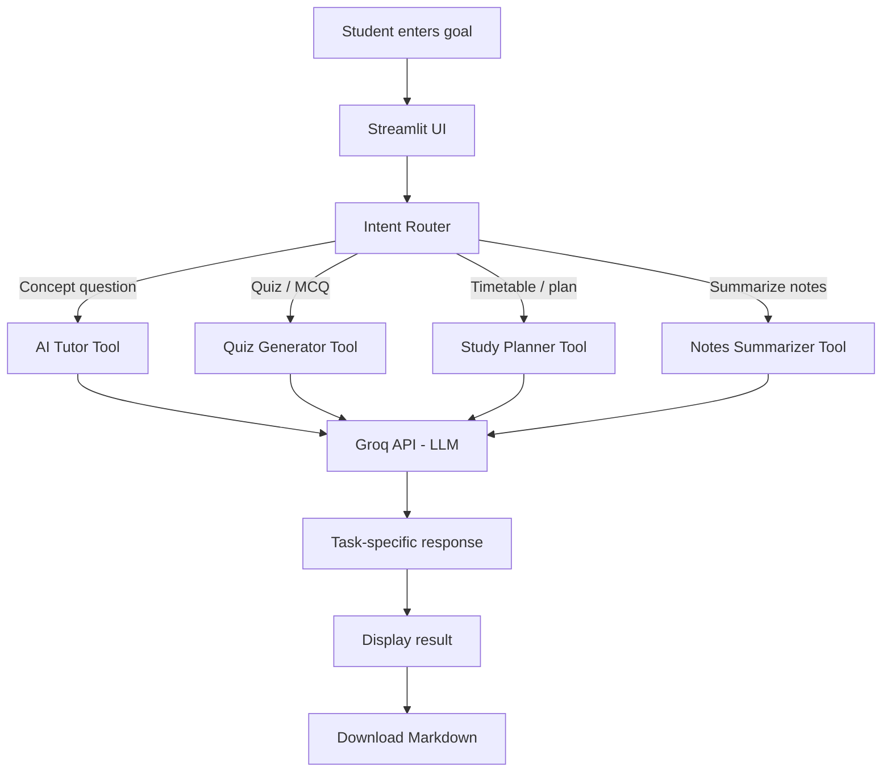

# StudyPilot AI — Agentic Study Assistant

StudyPilot AI is a small agentic AI application for students. It routes a user's goal to one of four specialist tools and uses a language model to produce a tailored result.

## Features
- **Agent Workspace:** automatically routes requests to a specialist based on intent.
- **AI Tutor:** explains a concept at the selected learning level.
- **Quiz Generator:** creates multiple-choice questions with answers and explanations.
- **Study Planner:** creates a schedule from subjects, available daily hours, and a target date.
- **Notes Summarizer:** turns pasted notes into structured revision material.
- **Export:** download generated results as Markdown files.

## Architecture / development schema



### Agent workflow
1. **Input:** the user describes a learning goal.
2. **Intent detection:** `route_task()` checks the request for intent keywords.
3. **Tool selection:** one specialist is selected: Tutor, Quiz Generator, Study Planner, or Notes Summarizer.
4. **Execution:** the selected tool's objective and the user's prompt are sent to the LLM.
5. **Output:** the result is displayed and can be downloaded.

> This is a lightweight, rule-based agent router with LLM-powered tools. It is a practical educational prototype, not a fully autonomous multi-agent system.

## Technology stack
- Python
- Streamlit for the interface
- Groq API using an OpenAI-compatible client
- Mermaid for the architecture diagram

## Run locally
1. Install Python 3.10 or newer.
2. Download or clone this repository.
3. Create and activate a virtual environment (recommended).
4. Install dependencies:
   ```bash
   pip install -r requirements.txt
   ```
5. Get an API key from [Groq Console](https://console.groq.com/keys).
6. Set the environment variable `GROQ_API_KEY`, or paste the key into the app sidebar for the current session.
   - Windows PowerShell:
     ```powershell
     $env:GROQ_API_KEY="your_key_here"
     ```
   - macOS/Linux:
     ```bash
     export GROQ_API_KEY="your_key_here"
     ```
7. Start the app:
   ```bash
   streamlit run app.py
   ```

## Deploy online
You can deploy the repository with Streamlit Community Cloud:
1. Push this project to a GitHub repository.
2. In Streamlit Community Cloud, create a new app and select the repository and `app.py`.
3. Add `GROQ_API_KEY` under the app's **Secrets** settings.
4. Deploy and test the public app URL.

## Suggested GitHub repository description
`Agentic AI study assistant with intent routing, AI tutoring, quiz generation, study planning, and notes summarization.`

## Academic submission checklist
- [ ] Source code uploaded to GitHub
- [ ] `README.md` and architecture schema included
- [ ] App tested with an API key
- [ ] GitHub repository URL copied into submission form
- [ ] If required, public deployed app URL added separately

## Limitations
- Intent routing uses keyword rules and may choose the wrong tool for ambiguous requests.
- The quality of generated content depends on the language model and API availability.
- Do not paste private, confidential, or sensitive material into the application.
