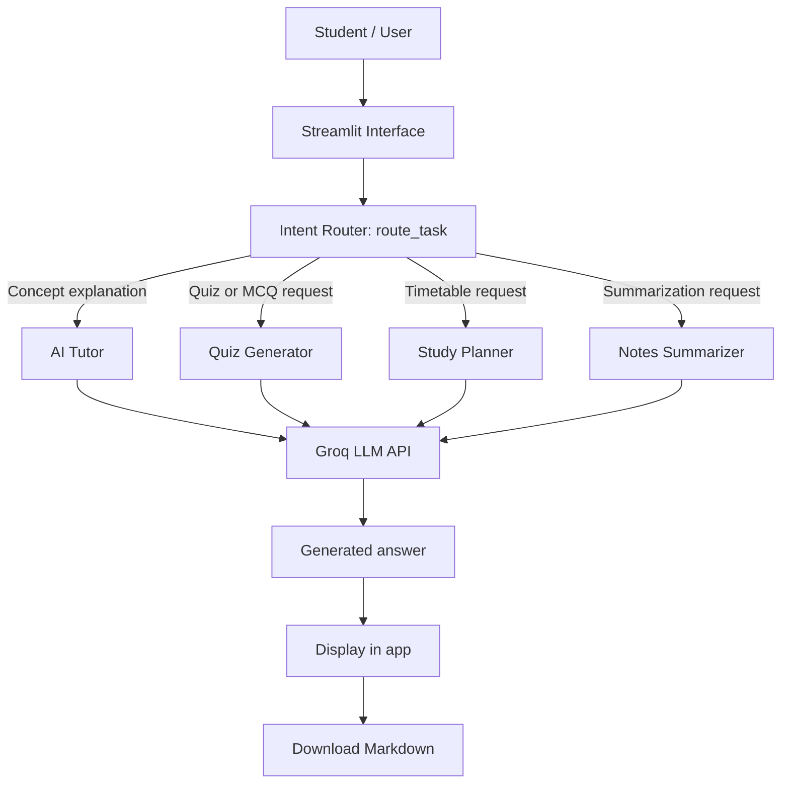

# StudyPilot AI — Development Schema

## System architecture

## Input / process / output schema

| Stage | Description | Example |
|---|---|---|
| Input | User goal or tool-specific form | “Create five MCQs on thermodynamics” |
| Intent detection | Keyword-based intent classification | `quiz`, `MCQ` → Quiz Generator |
| Tool selection | Select one specialist prompt | Quiz Generator |
| AI processing | Send selected tool instructions and user input to the LLM | Groq API |
| Output | Display a task-specific result | Questions, options, answers, explanations |
| Export | Let the user save the result | Markdown file |

## Agent decision logic

1. If the request contains `summarize`, `summary`, `condense`, or `revision notes`, route to **Notes Summarizer**.
2. Else if it contains `quiz`, `MCQ`, `multiple choice`, or `test me`, route to **Quiz Generator**.
3. Else if it contains `timetable`, `study plan`, `schedule`, or `plan my study`, route to **Study Planner**.
4. Otherwise route to **AI Tutor**.

## Main modules

- `app.py`: user interface, intent router, model call, output rendering.
- `requirements.txt`: Python dependencies.
- `.env.example`: example environment variable name; never put a real API key in GitHub.
- `README.md`: installation, run, deployment, and project documentation.
